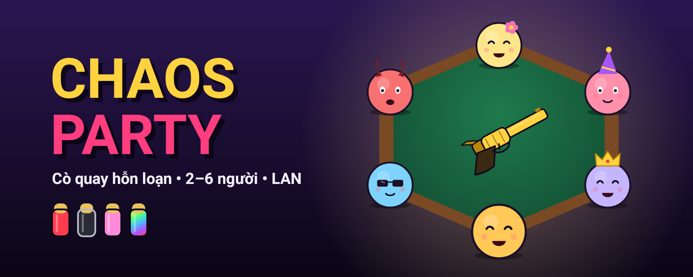
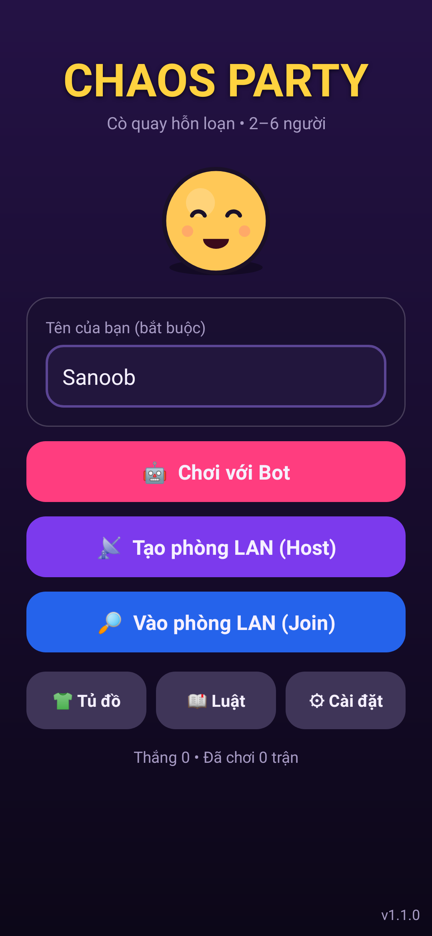
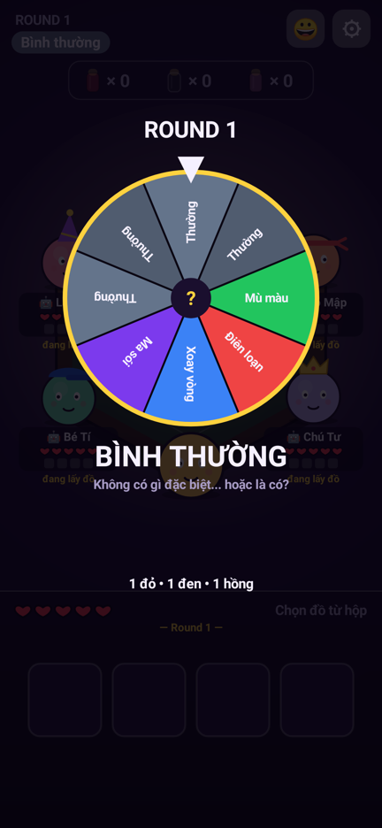
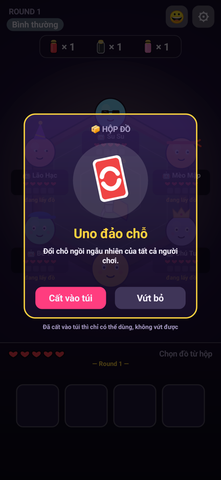
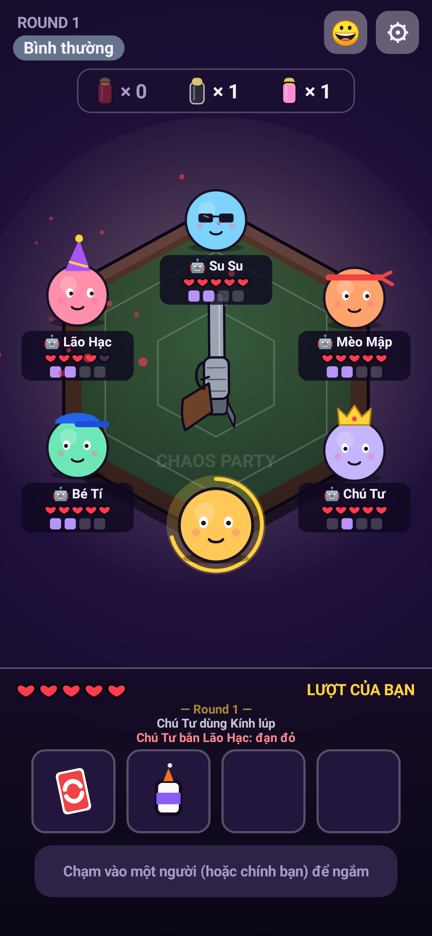
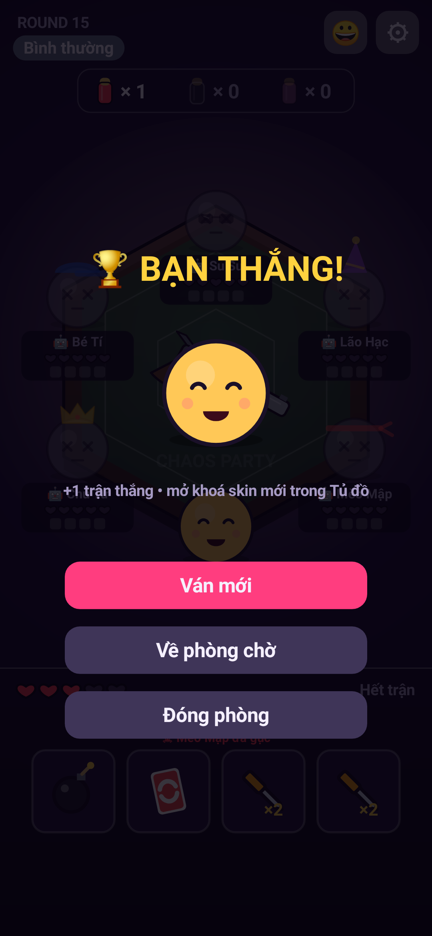

<p align="center">
  
</p>

<p align="center">
  <b>Cò quay hỗn loạn cho Android</b> · 2–6 người · chơi với bot hoặc bạn bè qua Wi-Fi
</p>

<p align="center">
  
  
  
  
</p>

<p align="center">
  <a href="https://github.com/sanoobk7/mobile-test/raw/claude/andokrd-game-app-cq2wtn/ChaosParty.apk"><b>⬇️ TẢI APK</b></a>
  &nbsp;·&nbsp; <a href="#-cài-đặt">Cài đặt</a>
  &nbsp;·&nbsp; <a href="#-luật-chơi">Luật chơi</a>
  &nbsp;·&nbsp; <a href="#-chơi-lan">Chơi LAN</a>
</p>

---

## 📸 Hình ảnh

<p align="center">
  
  
  
  
  
</p>
<p align="center"><sub>Menu · Vòng quay sự kiện · Hộp đồ · Bàn lục giác 6 người · Chiến thắng</sub></p>

## ✨ Tính năng

| | |
|---|---|
| 🎡 **Vòng quay 8 sự kiện** | Mỗi round một luật mới: Mù màu, Điên loạn, Xoay vòng… và Ma sói đội lốt "Bình thường" |
| 🔴⚫🩷 **3 loại đạn** | Đếm đạn còn lại hiện liên tục, không cần tự nhớ |
| 🎒 **8 món đồ, túi 4 ô** | Kim tiêm, Cái đục, Bom hẹn giờ, Giáp, Kính lúp, Uno đảo chỗ, Adrenaline, Keo mờ ám |
| 📡 **Chơi LAN tới 6 người** | Tự dò phòng trong cùng Wi-Fi/hotspot, host thêm bot vào ghế trống |
| 🤖 **Bot 3 cấp độ** | Bot chỉ biết những gì người thật biết, không gian lận |
| 👕 **Skin** | 10 nhân vật, 6 súng, 5 mặt bàn, mở khoá bằng số trận thắng |
| 😂 **Biểu cảm** | Gửi biểu cảm cho cả bàn giữa trận |
| 🎵 **Nhạc và âm thanh** | Tự tạo bằng code, không cần file nên APK rất nhẹ |

## 📲 Cài đặt

1. Mở link **[Tải APK](https://github.com/sanoobk7/mobile-test/raw/claude/andokrd-game-app-cq2wtn/ChaosParty.apk)** bằng **Chrome** trên điện thoại.
2. Tải xong bấm **Mở**. Nếu máy chặn, bật **"Cho phép cài từ nguồn này"**.
3. Bấm **Cài đặt**. Nếu Play Protect cảnh báo, chọn **"Vẫn cài đặt"** (app chưa đăng CH Play nên mới có cảnh báo này).

> 💡 Nếu điện thoại chỉ hiện nút *Giải nén*, đừng bấm. Mở file bằng app **Quản lý tệp** của máy, rồi chọn **Trình cài đặt gói**.

## 🎮 Luật chơi

**Mục tiêu:** mỗi người có 5 máu, người cuối cùng còn sống thắng.

**Mỗi round:** quay vòng sự kiện, súng được nạp 3–8 viên, mỗi người lấy 2 món từ hộp đồ (cất vào túi hoặc vứt).

| Đạn | Bắn người khác | Tự bắn mình |
|---|---|---|
| 🔴 **Đỏ** | -1 máu, hết lượt | -1 máu, hết lượt |
| ⚫ **Đen** | Không sao, hết lượt | Không sao, **được bắn tiếp** |
| 🩷 **Hồng** | Người đó **+1 máu**, hết lượt | +1 máu, hết lượt |

<details>
<summary><b>🎡 Sự kiện trên vòng quay</b></summary>

| Ô | Sự kiện | Hiệu ứng |
|---|---|---|
| ×4 | Bình thường | Không có gì đặc biệt |
| ×1 | 🌈 Mù màu | Mọi viên đạn hiện màu cầu vồng, phó mặc vận may |
| ×1 | 🌀 Điên loạn | 40% phát bắn đi lệch sang người ngẫu nhiên, kể cả bạn |
| ×1 | 🔄 Xoay vòng | Số lượt = số người còn sống, ai bị bắn sẽ cầm súng lượt sau |
| ×1 | 🐺 Ma sói | Đội lốt Bình thường. Bắn trúng ai thì người đó +1 phiếu, hết round ai nhiều phiếu nhất sẽ chết |

</details>

<details>
<summary><b>🎒 Đồ vật</b></summary>

| Đồ | Tác dụng |
|---|---|
| 💉 Kim tiêm | +1 máu, nhưng 25% bị sốc thuốc -2 máu |
| 🔨 Cái đục | Viên hiện tại ×2 sát thương. Nếu là đạn đỏ, 50% nổ ngòi -2 máu |
| 💣 Bom | Gài vào ô trống của người khác, nổ sau 3–8 lượt ngẫu nhiên, -3 máu. Người bị gài có thể chuyển bom đi. Tối đa 2 bom cùng lúc |
| 🛡 Giáp | +1 giáp (tối đa 3), mỗi giáp đỡ 1 sát thương |
| 🔍 Kính lúp | Nhìn lén viên hiện tại |
| 🔁 Uno đảo chỗ | Xáo ngẫu nhiên chỗ ngồi của mọi người |
| ⚡ Adrenaline | Hồi đầy máu, bắn ×2 sát thương, nhưng chết sau 2 round |
| 🧴 Keo mờ ám | Bí mật: viên tiếp theo sau phát bắn của bạn dội ngược vào người bắn |

</details>

## 📡 Chơi LAN

1. Tất cả máy dùng **chung một Wi-Fi**, hoặc bắt **hotspot** của một máy.
2. Một người bấm **Tạo phòng LAN** (có thể thêm bot dễ/thường/khó).
3. Những người còn lại bấm **Vào phòng LAN**, game tự tìm phòng. Nếu không thấy thì bấm **Nhập IP** và nhập IP hiện trong phòng.
4. Mỗi lượt có 45 giây. Ai thoát giữa trận thì bot chơi thay.

## 🗺️ Dự kiến

- [ ] Chơi online bằng mã phòng (không cần chung Wi-Fi)
- [ ] Đăng CH Play
- [ ] Thêm sự kiện và đồ vật mới

## 🛠️ Dành cho dev

```bash
./gradlew :app:assembleRelease     # APK
./gradlew :app:bundleRelease       # AAB để đăng CH Play
./gradlew :app:testDebugUnitTest --tests 'com.chaosparty.engine.*'   # giả lập 3000 trận
```

<details>
<summary>Cấu trúc code và ký APK</summary>

- `engine/`: luật chơi và bot, Kotlin thuần, có test giả lập 3000 trận
- `net/`, `session/`: LAN (TCP + dò phòng UDP). Host giữ luật, mỗi máy chỉ nhận thông tin mình được phép thấy
- `ui/`: màn hình vẽ bằng Canvas, âm thanh tổng hợp, skin

**Ký bản phát hành:** đặt `keystore.properties` (storeFile, storePassword, keyAlias, keyPassword) ở thư mục gốc,
hoặc thêm các secret `CP_KEYSTORE_B64`, `CP_KEYSTORE_PASSWORD`, `CP_KEY_ALIAS`, `CP_KEY_PASSWORD` cho GitHub Actions.
Nếu không có, APK được ký bằng khoá debug: cài được, nhưng không đăng CH Play được.

</details>
